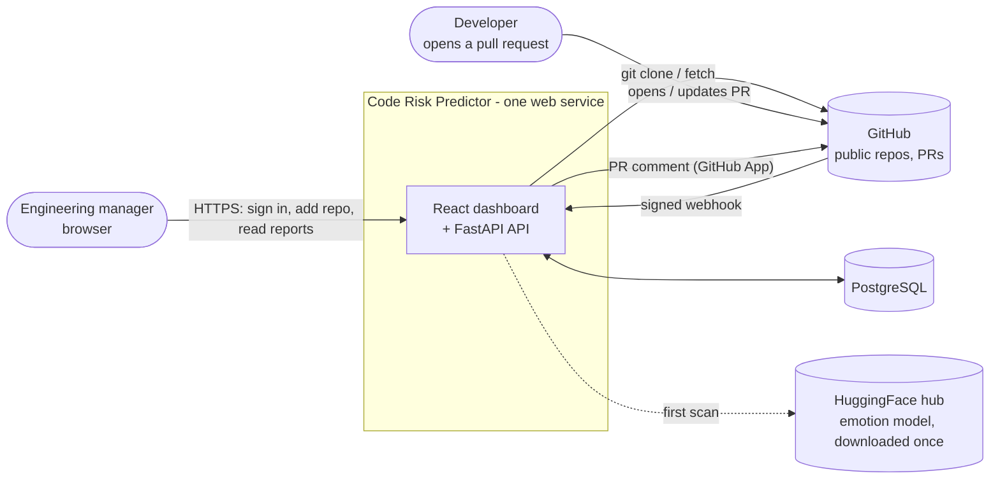
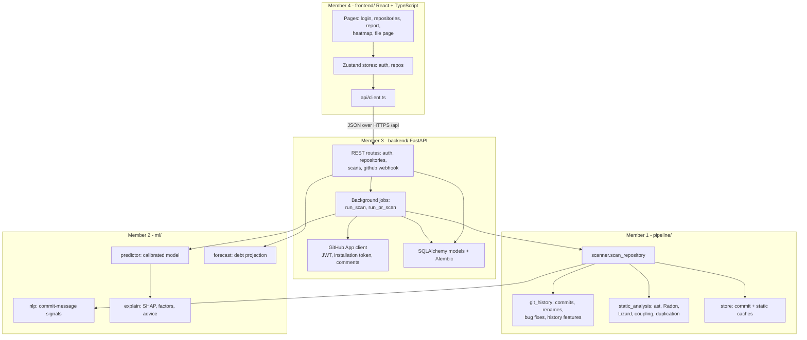
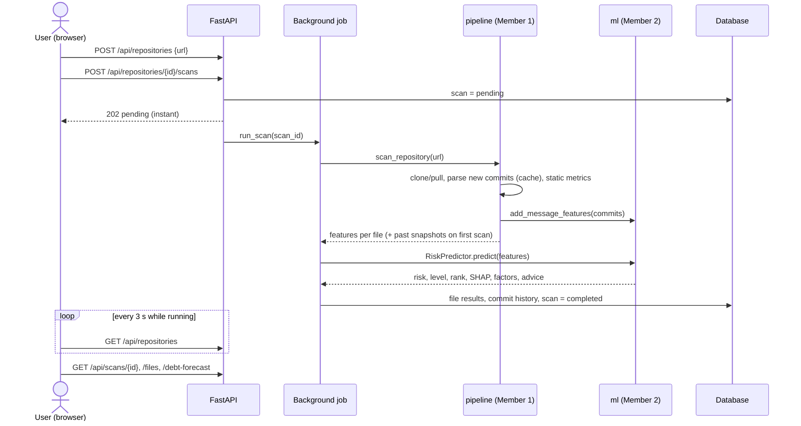
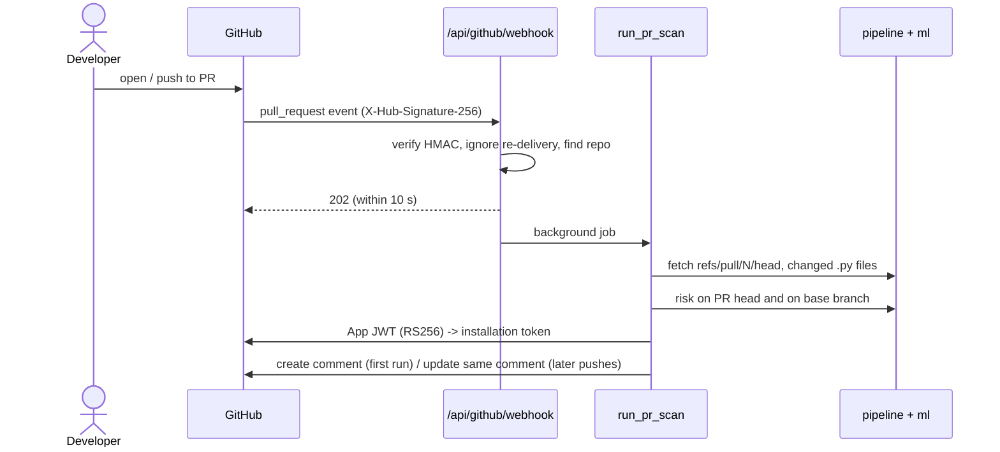
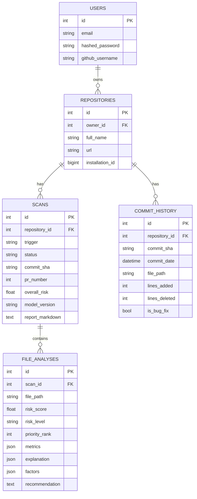
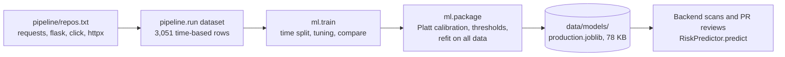
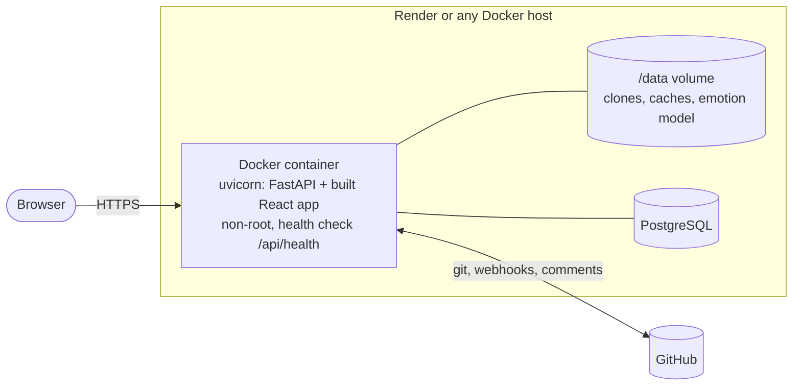

# Architecture

AI-Powered Code Complexity & Technical Debt Predictor: how the system is built and why.
The diagrams are Mermaid (GitHub renders them as pictures; in VS Code use a Mermaid preview).

## 1. System context

Who and what the system talks to.



## 2. Components (the four members' parts)



## 3. Scan flow (user adds a repository)



## 4. Pull-request flow (GitHub App)



## 5. Data model



`scans.trigger`: `manual`, `push` (default branch), `pull_request` (PR review, kept out of the
repo's trends), `history` (past snapshots computed on the first scan for the trend charts).

## 6. ML lifecycle (offline vs online)



Offline (run by us, minutes): build the dataset, train, calibrate, save one model file.
Online (every scan, seconds): load the model once, score today's features, explain.

## 7. Deployment



Image build: stage 1 builds the React app with Node; stage 2 is Python 3.13 slim + git +
CPU-only PyTorch, with the built dashboard and the trained model copied in. On start the
entrypoint waits for the database and runs `alembic upgrade head`.

## 8. Key design decisions

| Decision | Why | Trade-off |
|---|---|---|
| Time-based snapshots for training data | Labels come from the future of each snapshot, like real use; no leakage | Recent snapshots can't be labelled yet (dropped) |
| Logistic regression over XGBoost | Tied best on validation, least overfitting, exact and simple SHAP | Less flexible on bigger data |
| Platt calibration + data-driven levels | Scores become real probabilities; levels match real outcomes | Needs out-of-time predictions |
| SHAP grouped into factors | Exact (SHAP adds up) and readable; hides confusing signs of overlapping features | Less detail (detail still shown per metric) |
| Background tasks inside the API process | Simple, no extra infrastructure | Many users would need a job queue (RQ/Celery) |
| Dashboard served by the API server | One service, one URL, no CORS, one deploy | Frontend and backend scale together |
| Caches for commits and static metrics | Refresh 4.5 min → 40 s; past code never changes | Cache invalidation (versioned, force-push aware) |
| 404 for other users' data | Doesn't reveal that a resource exists | – |
| Signed webhooks, fail closed | Only GitHub can trigger PR reviews | Needs the secret configured |
| Pinned ML library versions | A pickled model must load with the versions it was trained with | Upgrades require retraining |

## 9. Repository layout

```
pipeline/   data extraction (Member 1)       ml/        ML, NLP, SHAP (Member 2)
backend/    API, DB, GitHub App (Member 3)   frontend/  React dashboard (Member 4)
tests/      52 automated tests               docs/      this file, deployment, demo, study guide
data/models/production.joblib                trained model (other data/ folders are generated)
Dockerfile, docker-compose.yml, render.yaml, docker/entrypoint.sh, backend/migrations/
```
